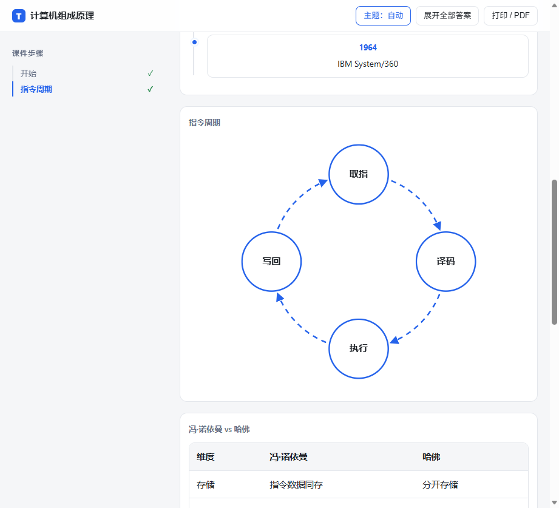
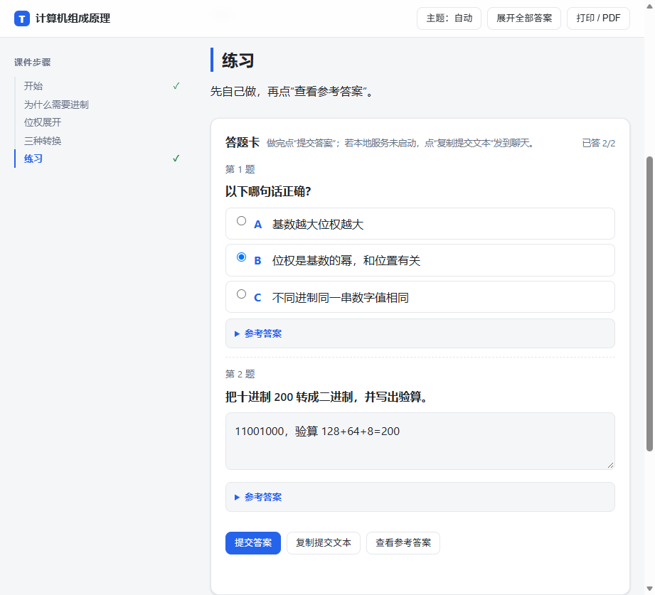

# Teacher.skill

> A good teacher isn't someone who gives you answers — it's someone who helps you find them.

[中文](README.md) · [Installation](#installation) · [Usage](#usage) · [FAQ](#faq) · [GitHub repo](https://github.com/BTHawake/Teacher_skill)

[](LICENSE)
[](https://agentskills.io)
[]()
[]()
[](https://claude.ai/code)
[]()

---

Throw a document, book, or course at an AI — it will teach you like a patient teacher. First it assesses your level, then it explains concepts in ways you can actually understand, step by step.

It never assumes you "should know" something, never jumps to the answer, and never skips a step. After each concept, it checks that you truly understand before moving on.

**v4.0 core capabilities**: **HTML is the classroom**. Each unit becomes a step-by-step HTML deck (explanations, diagrams, animations, answer card). Users read the deck and answer in chat; the AI reads the submitted answer card, then generates a reteach / practice / review page or the next unit based on mastery. 10 subjects ship with executable micro-flows (knowledge / methodology), plus a 5-minute lightweight micro-lesson.

Now supports **10 subjects**: Math, Programming, Chinese, English, Physics, Chemistry, History, Biology, AI, and Feynman Thinking.

---

## Installation

### Claude Code

```bash
# Project-level (current project only)
mkdir -p .claude/skills
git clone https://github.com/BTHawake/Teacher_skill .claude/skills/teacher-skills

# Global (available to all projects)
git clone https://github.com/BTHawake/Teacher_skill ~/.claude/skills/teacher-skills
```

> **Important**: Claude Code scans `.claude/skills/` from the git repo root. Make sure the directory structure is correct.

### OpenAI Codex CLI

```bash
# Enable skills feature
codex --enable skills

# Project-level
mkdir -p .codex/skills
git clone https://github.com/BTHawake/Teacher_skill .codex/skills/teacher-skills

# Global
git clone https://github.com/BTHawake/Teacher_skill ~/.codex/skills/teacher-skills
```

### OpenCode

```bash
# Project-level
mkdir -p .opencode/skills
git clone https://github.com/BTHawake/Teacher_skill .opencode/skills/teacher-skills

# User-level
git clone https://github.com/BTHawake/Teacher_skill ~/.config/opencode/skills/teacher-skills
```

### OpenClaw

```bash
git clone https://github.com/BTHawake/Teacher_skill ~/.openclaw/workspace/skills/teacher-skills
# Restart Gateway to apply
```

### DeepSeek Harness (DSH) — Windows CMD / PowerShell

DSH discovers `SKILL.md` under `.dsh/skills/` live, no restart needed. First verify Git is installed and on PATH:

```bat
git --version
```

#### Project-level (current workspace; run from the DSH workspace root)

**CMD**

```bat
if not exist ".dsh\skills" mkdir ".dsh\skills"
git clone https://github.com/BTHawake/Teacher_skill ".dsh\skills\teacher"
```

**PowerShell**

```powershell
New-Item -ItemType Directory -Force ".dsh\skills" | Out-Null
git clone https://github.com/BTHawake/Teacher_skill ".dsh\skills\teacher"
```

#### Global (all workspaces)

**CMD**

```bat
if not exist "%USERPROFILE%\.dsh\skills" mkdir "%USERPROFILE%\.dsh\skills"
git clone https://github.com/BTHawake/Teacher_skill "%USERPROFILE%\.dsh\skills\teacher"
```

**PowerShell**

```powershell
New-Item -ItemType Directory -Force "$HOME\.dsh\skills" | Out-Null
git clone https://github.com/BTHawake/Teacher_skill "$HOME\.dsh\skills\teacher"
```

#### Update

Run only the line matching where you installed it:

**CMD**

```bat
:: Project-level
git -C ".dsh\skills\teacher" pull --ff-only

:: Global
git -C "%USERPROFILE%\.dsh\skills\teacher" pull --ff-only
```

**PowerShell**

```powershell
# Project-level
git -C ".dsh\skills\teacher" pull --ff-only

# Global
git -C "$HOME\.dsh\skills\teacher" pull --ff-only
```

> `pull --ff-only` requires a clean local tree; if it fails, run `git -C "<install path>" status` or back up and reinstall.
> If you installed from a zip/manual copy (no `.git`), `pull` won't work — remove the folder and clone again.

Notes:

- DSH ignores extra frontmatter such as `allowed-tools` / `triggers`, but reads `name` / `description`
- Web tools are `web_search` / `web_fetch`; the pre-lesson search rule is platform-agnostic
- Open HTML decks directly in a browser, or serve them locally if `file://` is restricted

#### Accessing DSH remotely

The course server binds `127.0.0.1` by default. If you connect to DSH remotely, your browser's `127.0.0.1:8765` points to **your own machine**, not the DSH host. Forward both ports:

```bash
# SSH tunnel: forward DSH (3080) and course server (8765)
ssh -L 3080:127.0.0.1:3080 -L 8765:127.0.0.1:8765 user@host
```

Then:

- Start `python scripts/course_server.py --course "Course" --port 8765` on the DSH host
- Open `http://127.0.0.1:8765/` in your local browser
- Build decks with `--server-url` set to the URL your browser actually uses; same-origin pages derive it automatically

Other remote setups:

| Setup | How |
|-------|-----|
| VS Code Remote / JetBrains | Forward port `8765` in the Ports panel |
| Remote desktop | Open the browser inside the remote desktop and use `127.0.0.1:8765` |
| Tailscale / ZeroTier | Bind the Tailscale IP or use `--host 0.0.0.0`, then open `http://<tailscale-ip>:8765` (private network) |
| Public tunnel / reverse proxy | Add an `/api/answers` route and authentication; never expose 8765 naked to the internet |

> The answer card derives `/api/answers` from `location.href`, so sub-path reverse proxies work; only `file://` uses `data-server-url`.

### TRAE

TRAE uses Rules system instead of Skills directory. Copy `SKILL.md` as a rule file:

```bash
mkdir -p .trae/rules
cp teacher-skills/SKILL.md .trae/rules/teacher.md
```

Add TRAE metadata at the top of the rule file:

```yaml
---
description: "AI teacher: teaches any given material with personalized pace and style"
alwaysApply: false
priority: 2
---
```

In chat, reference with `#teacher`.

---

## Requirements

- Node.js 18+ (for Claude Code / Codex CLI)
- Git 2.0+ (for installing/updating via `git clone` / `git pull`)
- Claude Pro/Max subscription or Anthropic API Key (Claude Code)
- OpenAI API Key (Codex CLI)
- Python 3.9+ (required for HTML decks, the answer server, the mastery engine and progress scripts; not needed for chat-only use)

---

## Usage

After installation, just tell your AI:

```
teach me this document
```

Then paste or upload your material. The AI will automatically enter the teaching workflow.

You can also specify a topic directly:

```
/teacher machine learning
```

### v4.0 Classroom: HTML teaches, chat answers

```
Chat diagnosis → Generate unit HTML deck → User studies in HTML
                                            ↓
                         HTML answer card → submit to answers/latest.json
                                            ↓
                         User says "done" in chat → AI reads & grades
                                            ↓
              Generate: reteach / practice / review page / next unit
```

Chat has only four jobs: **diagnose, answer questions, grade, decide**. Explanations, diagrams, animations, examples and exercises live in HTML; the AI does not repeat them in chat.

Start the local course server:

```bash
python scripts/course_server.py --course "Computer Organization" --port 8765
# open http://127.0.0.1:8765/
```

Build a unit deck:

```bash
python scripts/lesson_html.py build --course "Computer Organization" \
  --file "讲义/Computer Organization/unit-04.md" \
  --state "teachers/Computer Organization/learning-state.json" \
  --server-url "http://127.0.0.1:8765"
```

Typical exchange:

```
❯ Unit 4 deck is ready (7 steps):
   http://127.0.0.1:8765/unit-04.html
   Read steps 2-4; submit the exercises and tell me "done".

❯ done

   Q1 ✅
   Q2 ❌ missed the final verification step.
   I added a worked example to the reteach page: [link]
   Try the 2 variants and send me your answers.
```

Advancing requires both the first check and a new-scenario variant. If not, the AI generates a reteach/practice page instead of rewriting the original deck.

### How vivid can the page be?

- Step transitions, progress bar, visited-step checkmarks, arrow-key navigation
- Flip cards, collapsible hints, one-click code copy, light/dark theme
- Animated flow arrows, layer-by-layer reveal, timeline entrance, rotating cycle arrows
- Answer-card submit state, answered count, print/PDF
- Diagram DSL: `flow` / `layers` / `timeline` / `cycle` / `compare` / `bars`; complex diagrams via SVG

### Imitating a Teacher's Style

Want the AI to teach in a specific instructor's style?

```
teach me linear algebra in this style
```

Then upload course subtitle files (SRT/VTT/TXT), or provide a video link (YouTube/Bilibili).

The AI will analyze the instructor's teaching style (sentence structure, vocabulary, pacing, interaction patterns, etc.) and teach in that style.

```
❯ 用这个风格教我（上传某名师的课程字幕）

   I'm analyzing this teaching material...

   Style analysis complete. This teacher's style is:
   "Uses dense short sentences and everyday analogies to break down complex concepts,
    confirms understanding with rhetorical questions after each point,
    catchphrases are 'right?' and 'it's simple'."

   I'll teach you in this style from now on.
   If it doesn't feel right, provide more material and I'll adjust.
```

### Management Commands

| Command | Description | Example |
|---------|-------------|---------|
| `/teacher status` | View current progress | `/teacher status` |
| `/teacher reset` | Reset teaching session | `/teacher reset` |
| `/teacher level` | Manually set ability level | `/teacher level advanced` |
| `/teacher skip` | Skip current unit | `/teacher skip` |
| `/teacher review` | Open the lesson index and review due items (v4.0) | `/teacher review` |
| `/teacher quick` | Lightweight mode: one-page HTML micro-lesson | `/teacher quick what is place value` |
| `/teacher serve` | Start the local course/answer server (v4.0) | `/teacher serve` |
| `/teacher answer` | Read `answers/latest.json`, grade and record mastery (v4.0) | `/teacher answer` |
| `/teacher practice` | Generate 3 targeted exercises as an HTML page | `/teacher practice` |
| `/teacher reteach` | Generate a reteach page for the current weak point (v4.0) | `/teacher reteach place value` |
| `/teacher mastery` | Show Lv0-Lv3 mastery and next review | `/teacher mastery` |
| `/teacher export` | Export current unit as an HTML deck | `/teacher export` |
| `/teacher rebuild` | Rebuild all HTML for current course | `/teacher rebuild` |
| `/teacher html on/off` | Toggle auto HTML after each unit | `/teacher html off` |
| `/teacher quit` | End current session | `/teacher quit` |
| `/teacher style` | View current style profile | `/teacher style` |
| `/teacher style off` | Disable style imitation | `/teacher style off` |
| `/teacher style more` | Intensify style imitation | `/teacher style more` |
| `/update-teacher {slug}` | Append material to evolve profile | `/update-teacher prof-wang` |
| `/list-teachers` | List all created teaching profiles | `/list-teachers` |
| `/teacher rollback {v}` | Rollback to a specific version | `/teacher rollback v3` |

---

## v4.0 Changelog

| Capability | Description |
|------------|-------------|
| **HTML-first** | HTML is the classroom; chat only diagnoses / answers / grades / decides |
| **Step deck** | One deck per unit: progress bar, visited steps, keyboard navigation |
| **Answer card + server** | Users submit; AI reads `answers/latest.json` and grades |
| **Reteach/practice/review pages** | Decisions become separate HTML pages; original deck stays stable |
| **Diagram DSL** | flow / layers / timeline / cycle / compare / bars + raw SVG |
| **Animations & interactions** | Theme toggle, flip cards, hints, code copy, SVG animations |
| **Adaptive mastery** | Lv0-Lv3; advance only after first check + variant |
| **Review schedule** | 1/3/7/14/30 days; when >5 items are due, process only 3 this session |
| **Tests / CI** | 36 unit tests; GitHub Actions on Python 3.9-3.12 |

---

## Features

### Student Assessment

Assess the learner's ability through natural conversation, without making them feel like they're being "tested".

| Level | Indicators | Teaching Strategy |
|-------|-----------|------------------|
| 🔴 Beginner | No prior knowledge, unfamiliar with domain terms | Lecture + heavy analogies + small steps |
| 🟡 Intermediate | Vague familiarity, concepts not clear | Scaffolded instruction + progressive exercises |
| 🟢 Advanced | Can accurately describe core concepts | Inquiry-based + challenging exercises |

Assessment is not one-time. The AI continuously adjusts its diagnosis based on learner performance during the session.

### Three-Level Teaching Strategy

| | 🔴 Beginner | 🟡 Intermediate | 🟢 Advanced |
|---|-------------|-----------------|-------------|
| **Method** | Lecture + heavy analogies | Scaffolded instruction | Inquiry-based |
| **Lecture/Practice** | 70% / 30% | 50% / 50% | 30% / 70% |
| **Check method** | Multiple choice / True-false | Retell / Application | Analysis / Design |
| **Pacing** | Slow, check every step | Medium, check per concept | Fast, check every 2-3 concepts |

### Plain Language Teaching

Built-in analogy library that translates abstract concepts into everyday language:

| Abstract Concept | Analogy |
|-----------------|---------|
| Algorithm | Recipe |
| Cache | Refrigerator |
| Recursion | Russian nesting dolls |
| API | Restaurant waiter |
| Container (Docker) | Shipping container |
| Version Control (Git) | Game save points |

### Evolution Mechanism

Teaching profiles support three ways to evolve:

- **Append Material**: Provide new course material, incrementally merged into existing profile — never overwrites existing conclusions
- **Conversation Correction**: Say "that's not right" / "the teacher wouldn't say that" — takes effect immediately and records a Correction
- **Version Management**: Auto-archive before each update, keep up to 10 historical versions, supports rollback

### Style Imitation

Upload course subtitles or provide a video link — the AI automatically extracts the teacher's style and imitates it:

| Input Method | Description |
|-------------|-------------|
| Subtitles (SRT/VTT/TXT) | Best quality, upload file directly |
| Video link (YouTube/Bilibili) | Auto-extract subtitles (requires yt-dlp) |
| Transcript/Article | Paste teaching text directly |

Style analysis covers six dimensions: sentence structure, vocabulary, teaching pacing, interaction patterns, content organization, and emotional tone.

> **Dependency**: Video subtitle extraction requires `yt-dlp` (`pip install yt-dlp`). If the video lacks subtitles, please upload subtitle files directly.

### HTML Classroom (v4.0)

Each unit becomes a **step-by-step HTML deck** containing explanations, diagrams, animations, examples and exercises. Chat only sends navigation and feedback.

```
讲义/Computer Organization/
├── index.html                 # progress, due reviews, weak points, AI next step
├── unit-04-进位计数制.html     # step deck + diagrams + answer card
├── practice-04-错题变式.html   # practice page
├── reteach-04-位权.html        # reteach page
└── answers/latest.json         # answer-card submission (AI reads it)
```

- Step navigation, progress bar, visited-step checkmarks, arrow keys
- Flip cards, hints, code copy, light/dark theme
- Animated flow arrows, layer reveal, timeline entrance, cycle arrows
- Answer card: submit to local server, or copy the submission text into chat
- Offline single file; print/PDF friendly





```bash
# Start the course/answer server
python scripts/course_server.py --course "Computer Organization" --port 8765

# Build a deck
python scripts/lesson_html.py build --course "Computer Organization" \
  --file "讲义/Computer Organization/unit-04.md" \
  --state "teachers/Computer Organization/learning-state.json" \
  --server-url "http://127.0.0.1:8765"
```

Diagram DSL: `flow` / `layers` / `timeline` / `cycle` / `compare` / `bars`; complex diagrams via SVG.
See [`ref/html-first-teaching.md`](ref/html-first-teaching.md) and [`ref/html-lessons.md`](ref/html-lessons.md).

### Adaptive Teaching (v4.0)

After each unit, run 3 exercises (concept / application / transfer), record mastery, then decide:

| Level | Evidence | Default action |
|-------|----------|----------------|
| Lv0 Not mastered | Wrong / cannot explain | Re-teach with another representation |
| Lv1 Vague | Partially correct / needs hints | 2 targeted exercises |
| Lv2 Basically mastered | First check passed | 1 new-scenario variant |
| Lv3 Mastered | First check + variant passed | Advance + spaced review |

- **Answer source**: read `讲义/{course}/answers/latest.json` first; fall back to answers pasted in chat
- **Advance gate**: first check + variant must both pass; doing one original question is not enough
- **Decision order**: recent fail → re-teach; partial → practice; due → review (>5 due: do 3, defer the rest); Lv2 → variant; all Lv3 → advance
- **Actions become pages**: reteach / practice / review page / next unit deck
- **Autonomy**: within-unit adjustments are automatic; changing units/route requires confirmation
- **Review**: 1/3/7/14/30 days; when >5 items are due, process only 3 this session

```bash
python scripts/mastery.py record --state "teachers/course/learning-state.json" \
  --concept "place value" --unit U4 --kind first --result pass
python scripts/mastery.py advise --state "teachers/course/learning-state.json"
```

See [`ref/adaptive-teaching.md`](ref/adaptive-teaching.md).

### Subject Plugins (v4.0)

Each `subjects/*.md` carries `type: knowledge | methodology` and a 5-step micro-flow. The main SKILL dispatches; the subject file defines how that subject is taught. See [`ref/subject-plugins.md`](ref/subject-plugins.md).

### Lightweight Mode (v4.0)

"Explain it briefly / five minutes / `/teacher quick`" → generate a one-page HTML micro-lesson (one concept + one example + one check), without the full Phase 0-2. Offer to expand into a full unit afterwards.

### Pre-Lesson Search Verification (v4.0 revision)

Before each new unit, verify at least 2 authoritative sources with the platform's web tools. If every source is unreachable:

1. Briefly state the tools tried and why they failed
2. **Ask once**: continue with existing materials + my knowledge (mark "not web-verified"), or fix the network first?
3. If the user chooses to continue, don't ask again this session; mark volatile facts as "not web-verified"
4. Never fabricate sources; if nothing was found, say "based on chapter X of the textbook"

When search succeeds, cite the sources and continue without interrupting the lesson.

### Assessment System (v2.8 New)

Question-based assessment replaces verbal review. Every knowledge point is verified with test questions, not "tell me what this is."

| Type | Trigger | Format |
|------|---------|--------|
| **Mini Assessment** | After every 1-2 units | 1-2 questions per unit |
| **Major Assessment** | After a major module (4-5 units) | Cross-topic comprehensive questions |

Flow: Ask question → User answers → Grade with feedback → Next question. Wrong answers get a simplified re-explanation followed by a same-type variation question. Track accuracy per unit; weak areas get priority in next review.

### Exam Pattern Teaching Method (v2.8)

When facing real exam papers, focus on patterns and techniques with real questions as practice — not grinding through every question. Reorganize all questions by solution model:

Questions → Extract common patterns → Group into scoring models → Teach techniques per model → Verify with real questions

Each model includes: applicable question types, core technique, key formulas, common traps, and a one-line memory hook. Start with a score distribution map so students know where the most points are, then teach model by model.

### Cross-Disciplinary Thinking (v2.0)

No longer teaching subjects in isolation — networked knowledge connections are woven into the entire teaching workflow, helping learners build cross-disciplinary thinking habits.

| Capability | Description | When |
|-----------|-------------|------|
| **Knowledge Networking** | 12 core concepts mapped across 6+ disciplines (e.g. "feedback" in biology=homeostasis, in electronics=circuit, in programming=recursion) | Naturally woven into concept explanations |
| **Analogical Transfer** | Structured 3-step analogy: extract pattern from familiar domain → apply to new concept → verify understanding | When introducing new concepts |
| **Association Spark** | 3-sentence association exercise + cross-domain 5-questions + 10 cross-pollination cards (e.g. "If this concept were a product...") | Post-lesson review / periodic review |

Cross-disciplinary connections aren't extra burden — good cross-disciplinary teaching gives every concept "one more dimension." When you learn math and see echoes of physics, learn physics and catch hints of chemistry — knowledge comes alive.

See `ref/cross-disciplinary-thinking.md` for details.

---

## Project Structure

```
teacher-skills/
├── SKILL.md                              # Main entry: HTML-first orchestrator (v4.0)
├── README.md                             # Chinese documentation
├── README_EN.md                          # English documentation
├── LICENSE                               # MIT License
│
├── config/
│   └── skill-config.json                 # Project configuration
│
├── prompts/
│   ├── lesson_template.md               # Step-deck template (v4.0)
│   ├── practice_template.md             # Practice page template (v4.0)
│   ├── reteach_template.md              # Reteach page template (v4.0)
│   ├── review_template.md               # Review page template (v4.0)
│   ├── intake.md                       # Teacher info intake (3 questions + tag library)
│   ├── style-extractor.md              # Teaching style 6-dimension extraction guide
│   ├── style-profile-template.md       # Teaching style profile template
│   ├── teaching_analyzer.md            # Teaching style analysis prompt
│   ├── teaching_builder.md             # Teaching profile generation template (Layer 0-5)
│   ├── merger.md                       # Incremental merge prompt
│   └── correction_handler.md           # Conversation correction handler
│
├── scripts/
│   ├── lesson_html.py                   # Markdown → step deck + answer card + index (v4.0)
│   ├── course_server.py                 # Local course server + answer submission (v4.0)
│   ├── mastery.py                       # Mastery / review / next-step engine (v4.0)
│   ├── generate_quiz.py                # Quiz generator
│   ├── evaluate_answer.py              # Answer evaluation
│   ├── track_progress.py               # Progress tracker
│   ├── learning_state.py               # Learning state persistence (v4.0)
│   ├── reverse_distill.py              # Reverse-distillation tool (v2.1)
│   ├── extract_subtitle.py             # Subtitle extraction
│   └── skill_writer.py                 # Teaching profile manager
│
├── tests/                              # Unit tests (v4.0)
│   ├── test_lesson_html.py
│   ├── test_mastery.py
│   └── test_course_server.py
│
├── examples/                           # Buildable demo deck / exercises
│   ├── lesson-demo.md
│   └── practice-demo.md
│
├── docs/                               # Documentation screenshots
│   ├── html-first-cycle.png
│   └── html-first-quiz.png
│
├── ref/
│   ├── learner-diagnosis.md              # Student assessment guide
│   ├── teaching-strategies.md            # Three-level teaching strategies
│   ├── teaching-techniques.md            # Plain language techniques + analogy library
│   ├── question-templates.md             # Question template library
│   ├── teaching-sop.md                   # Teaching SOP (HTML-first Phase 3)
│   ├── html-first-teaching.md            # HTML-first teaching method (v4.0)
│   ├── adaptive-teaching.md              # Adaptive teaching engine (v4.0)
│   ├── html-lessons.md                   # HTML deck/diagram/answer-card guide (v4.0)
│   ├── subject-plugins.md                # Subject plugin protocol (v4.0)
│   ├── management-commands.md            # Management commands
│   ├── verification-framework.md         # Teaching verification framework
│   ├── extraction-framework.md           # Unified extraction framework (v2.4)
│   ├── skill-to-curriculum-guide.md      # Skill-to-curriculum guide
│   ├── cross-disciplinary-thinking.md   # Cross-disciplinary thinking module (v2.0)
│   ├── deliberate-practice-research.md   # Deliberate practice research (v2.5)
│   ├── forgetting-curve-research.md      # Forgetting curve research (v2.6)
│   ├── nuwa-absorption.md               # Nuwa.skill absorption report
│   ├── reverse-distillation-report.md   # Reverse distillation research report
│   ├── unified-extraction-research.md    # Unified extraction research
│   └── improvement-roadmap.md            # Improvement roadmap
│
├── adapters/
│   └── trae-teacher.md                   # TRAE platform adapter
│
├── .github/workflows/
│   └── ci.yml                            # Unit tests + compile checks (v4.0)
│
└── subjects/
    ├── _template-SKILL.md                # Subject skill template (reusable, v4.0 micro-flow)
    ├── math-teacher-SKILL.md             # Math teaching strategy
    ├── programming-teacher-SKILL.md      # Programming teaching strategy
    ├── chinese-teacher-SKILL.md          # Chinese teaching strategy
    ├── english-teacher-SKILL.md          # English teaching strategy
    ├── physics-teacher-SKILL.md          # Physics teaching strategy
    ├── chemistry-teacher-SKILL.md        # Chemistry teaching strategy
    ├── history-teacher-SKILL.md          # History teaching strategy
    ├── biology-teacher-SKILL.md          # Biology teaching strategy
    ├── ai-teacher-SKILL.md               # AI / Artificial Intelligence
    └── feynman-teacher-SKILL.md          # Feynman Thinking (reverse-distilled) teaching strategy
```

---

## Available Subjects

| Subject | File | Coverage |
|---------|------|----------|
| Math | `subjects/math-teacher-SKILL.md` | Formula intuition, geometry visualization, proof strategies |
| Programming | `subjects/programming-teacher-SKILL.md` | Code thinking, debugging skills, project-driven learning |
| Chinese | `subjects/chinese-teacher-SKILL.md` | Classical Chinese, reading comprehension, writing |
| English | `subjects/english-teacher-SKILL.md` | Grammar, vocabulary, speaking, listening, test prep |
| Physics | `subjects/physics-teacher-SKILL.md` | Concept understanding, formulas, experimental thinking |
| Chemistry | `subjects/chemistry-teacher-SKILL.md` | Reactions, equations, lab skills, calculations |
| History | `subjects/history-teacher-SKILL.md` | Timelines, causal analysis, source interpretation |
| Biology | `subjects/biology-teacher-SKILL.md` | Cells, genetics, physiology, evolution, ecology |
| AI / AI时代 | `subjects/ai-teacher-SKILL.md` | LLM fundamentals, Prompt engineering, Agents, AI ethics |
| Feynman Thinking (reverse-distilled) | `subjects/feynman-teacher-SKILL.md` | Don't fool yourself, naming≠understanding, concrete thinking, deep play |

> Since v4.0, every subject file carries `type: knowledge | methodology` metadata and a 5-step micro-flow. Copy `_template-SKILL.md` when adding a subject.

## Creating New Subjects

Copy the template and create a new subject skill:

```bash
cp subjects/_template-SKILL.md subjects/your-subject-SKILL.md
```

Edit `your-subject-SKILL.md` with your subject's unique teaching strategies, common misconceptions, and exercise design. PRs for new subjects are welcome!

---

## FAQ

### Do I need Python?

Not for chat-only use. HTML decks, the answer server, the mastery engine and progress scripts require Python 3.9+.

### Where are lessons saved?

Under the workspace root where you started the AI:

```
讲义/Computer Organization/unit-04-进位计数制.html
讲义/Computer Organization/index.html
讲义/Computer Organization/answers/latest.json
```

### How do I submit answers?

Start the local server:

```bash
python scripts/course_server.py --course "Computer Organization" --port 8765
```

Open `http://127.0.0.1:8765/`, answer in the deck's answer card, click "submit", then tell the AI "done" in chat. The AI reads `answers/latest.json` and grades. Without the server, click "copy submission" and paste it into chat.

### How do I review?

Open `讲义/{course}/index.html`. Due items, weak concepts and the AI's next step are on the home page. Inside a unit, answers are collapsed by default — try first, then reveal.

### How is mastery calculated?

Lv0 Not mastered / Lv1 Vague / Lv2 Basically mastered / Lv3 Mastered. A first-check pass records Lv2; passing one new-scenario variant raises it to Lv3 and unlocks advancing.

### Is my data uploaded?

No. Learning state, decks and answer files stay local. `teachers/`, `讲义/` and `.dsh-meow/` are excluded in `.gitignore`.

### Which formats are supported?

PDF, TXT, Markdown, HTML, DOCX, EPUB.

---

## Notes

- ⚠️ This Skill does not replace professional education. Use with formal curricula for complex subjects.
- ⚠️ AI may produce hallucinations. Cross-reference critical information against original sources.
- All teaching data is stored locally. Nothing is uploaded to any server.
- Supported formats: PDF, TXT, Markdown, HTML, DOCX, EPUB

---

## Community

| Project | Description |
|---------|-------------|
| [ex-skill](https://github.com/therealXiaomanChu/ex-skill) | Ex.skill — inspiration source |
| [colleague-skill](https://github.com/titanwings/colleague-skill) | Colleague.skill — workplace relationship distillation |
| [awesome-persona-skills](https://github.com/tmstack/awesome-persona-skills) | Curated collection of persona skills |
| [superpowers](https://github.com/obra/superpowers) | Claude Code enhancement skill pack |

---

### A Final Word

The essence of education is not filling a bucket, but lighting a fire.

In reality, most people's learning experience looks like this: opening a thick textbook, dozing off after two pages; binge-watching tutorial videos, remembering nothing after closing them; asking an AI a question, getting an encyclopedia-length answer that leaves you more confused than before.

This Skill exists to do one simple thing: **make AI teach you like a real, good teacher.**

Not because it's smarter, but because it's more patient. It will wait for you. It will explain the same concept in different ways. It will pause when you're lost instead of barreling ahead. It never assumes you "should know" something — because good teachers never do.

If you've ever given up on learning something because "no one was there to teach you" — maybe try again.
